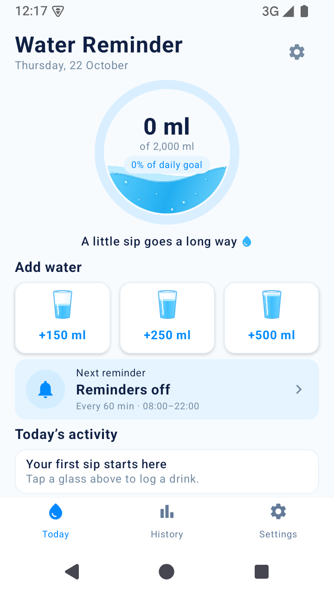

# Water Reminder

A native Android app for tracking daily water intake and scheduling reminders around your day. Built with Kotlin and Jetpack Compose, with all tracking data stored on your device.

**Current version:** 0.2.0 · **Minimum Android version:** Android 8.0 (API 26)

## Preview



The compact Today screen keeps the quick-add buttons visible when you open the app. This screenshot shows the app running on an Android API 35 emulator.

## Features

- **Daily progress:** view your total intake, daily goal, and completion percentage in a circular water graphic.
- **Quick logging:** add water with one tap, customize the three quick-add amounts, or enter a custom amount.
- **Entry management:** undo a new entry or review and delete a drink with confirmation.
- **Hydration history:** browse weekly charts, select individual days, and review daily totals and goal completion.
- **Flexible reminders:** choose an interval and active hours, with reminder status displayed on Today.
- **Local storage:** entries and preferences stay on your device. No account or internet connection is required to use the app.

## Getting started

1. Open **Settings** to choose your daily goal and quick-add amounts.
2. Enable reminders, select your interval and active hours, and allow notifications when prompted.
3. On **Today**, tap a glass to log water. Scroll below today's activity to enter a custom amount.
4. Open **History** to review previous days and weekly progress.

The starting values are a 2,000 ml goal, quick-add amounts of 150 / 250 / 500 ml, and a 60-minute reminder interval between 08:00 and 22:00. All are editable; reminders start disabled.

### How reminders work

Logging a drink restarts the reminder interval. Reminders run during your selected active hours and pause for the day when you reach your goal. The schedule is restored after a reboot or app update and adjusted when the device time or timezone changes.

Android may delay notifications to conserve battery, so delivery is not guaranteed at an exact time. Force-stopping the app cancels its alarms until you open it again. Active hours must start and end within the same day; overnight schedules are not supported yet.

## Build and run

### Requirements

- Android Studio with Android SDK Platform 35 installed
- JDK 17 for Gradle
- An emulator or Android device running API 26 or later

### Android Studio

1. Clone the repository:

   ```bash
   git clone https://github.com/gofrane/water-reminder.git
   ```

2. Open the `water-reminder` folder in Android Studio.
3. Select JDK 17 as the Gradle JDK and let Gradle sync finish.
4. Choose an emulator or connected device, then run the **app** configuration.

### Command line

Run commands from the project root. Set `JAVA_HOME` to your JDK 17 installation and configure the Android SDK through `ANDROID_HOME` or an untracked `local.properties` file containing `sdk.dir`.

**Windows PowerShell**

```powershell
.\gradlew.bat assembleDebug
```

**macOS / Linux**

```bash
./gradlew assembleDebug
```

The first build needs internet access to download dependencies. The Gradle wrapper is included, so a separate Gradle installation is not required.

The debug APK is generated at `app/build/outputs/apk/debug/app-debug.apk`. With ADB available, install it on a connected device or running emulator:

```bash
adb install -r app/build/outputs/apk/debug/app-debug.apk
```

## Development and validation

The project uses Kotlin 2.0.21, Jetpack Compose with Material 3, Android Gradle Plugin 8.9.2, and Gradle 8.11.1. Compile and target SDK are both 35. Build versions are pinned in the Gradle files.

Run the unit tests, Android lint, and debug build:

```powershell
.\gradlew.bat testDebugUnitTest lintDebug assembleDebug
```

On macOS or Linux, use `./gradlew` in place of `.\gradlew.bat`.

Recorded validation:

- **Reliability changes, 21 October 2026:** all 21 unit tests passed, covering hydration calculations, reminder scheduling, and saved-data validation and recovery.
- **Today screen update, 22 October 2026:** debug build and lint passed with zero errors and six existing warnings. The updated app was installed and visually checked on an API 35 emulator, including navigation and preserved history.
- **Earlier reminder checks:** notification delivery, permission handling, goal-based pausing, alarm cancellation, and reboot restoration were exercised on an API 37 emulator.

Physical-device coverage, larger font sizes, TalkBack, and extended battery-management testing remain part of release acceptance. See the [emulator test report](docs/testing/EMULATOR_TEST_REPORT.md) and [first-version review](docs/testing/V1_REVIEW.md) for evidence and limitations.

## Privacy and storage

Water entries and preferences are stored in the app's private storage. The app does not request internet access. Notification permission enables reminders; boot-completed permission allows the schedule to resume after a restart.

Android backup and device-transfer exclusions are configured for app data. Uninstalling the app removes its saved history. Export, accounts, and cloud sync are not implemented.

## Project guide

| Location | Purpose |
| --- | --- |
| `app/src/main/java/com/waterreminder/app/` | Compose screens, hydration logic, storage, and reminder scheduling |
| `app/src/main/res/` | Icons, themes, and backup rules |
| `app/src/test/` | JVM unit tests |
| `docs/testing/` | Review notes, emulator reports, and screenshots |
| [APP_PLAN.md](APP_PLAN.md) | Feature scope and original design plan |

The first version focuses on daily tracking and reminders. Dark mode, additional languages and units, widgets, monthly charts, export, and cloud sync are future possibilities outside the current scope.
