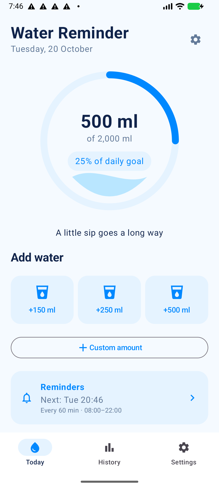
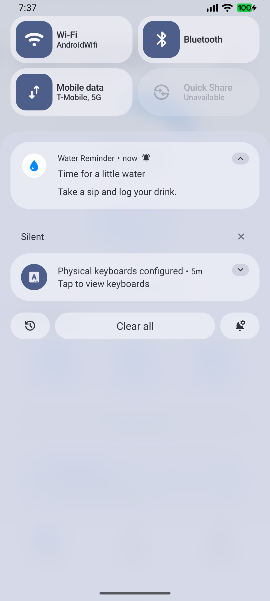

# Android emulator validation

Date: 20 October 2026.

Environment: isolated `WaterReminder_Test` AVD using the installed Android API 37 Google Play x86_64 image, 2 GB RAM, software graphics, Vulkan disabled, Windows Hypervisor Platform. Tested the debug APK produced by the Stage 3 build.

## Verified on the emulator

- APK installs and Water Reminder launches.
- Today renders the progress ring, quick-add controls, custom amount action, and reminder status.
- Logging 250 ml changes the total to 250 ml and writes the timestamped entry to private storage.
- The saved 250 ml entry survives app recreation and the emulator reboot.
- History displays the saved drink in its seven-day chart, daily average, and selected-day total.
- Settings displays editable goals and reminder controls.
- Enabling reminders first shows the in-app explanation and then Android's notification permission prompt.
- Denying permission shows the blocked status; no reminder alarm is registered.
- The blocked-status link opens the correct Android notification channel settings.
- After granting permission and returning to the app, an RTC_WAKEUP alarm is registered with Android.
- A real AlarmManager broadcast posts the notification titled “Time for a little water” and schedules the following reminder.
- Tapping the delivered notification opens Today.
- Editing the goal to 250 ml, with an existing 250 ml drink, shows 100% and “Goal reached · paused for today.” The next alarm moves to 08:00 the following day.
- Turning reminders off removes the scheduled alarm. Turning them back on restores the next-day schedule.
- After a real emulator reboot, Android delivered the queued boot broadcast and the 08:00 alarm was restored without opening Water Reminder. The image delayed boot-broadcast delivery for several minutes after its initial boot-complete status.
- After restoring the pre-fixture settings and drink entry, logging another 250 ml updates the total to 500 ml. The next scheduled alarm is exactly 3,600,000 milliseconds after the new drink's timestamp, confirming that logging restarts the selected 60-minute interval.

## Test method and limits

To verify real notification delivery without waiting 60 minutes, the isolated debug app was stopped and its private test timer and drink timestamp were backdated by two hours. Permission remained granted and the real application, receiver, notification channel, and AlarmManager code ran unchanged. Notification presence and the following alarm were confirmed through Android system dumps and an on-screen notification capture.

The Android 37 image showed preinstalled launcher/System UI stalls during first boot, and Google Play services and Digital Wellbeing crash dialogs. Google Play services and Digital Wellbeing were disabled only in this isolated test AVD to prevent interruptions. This app does not use those services. No Water Reminder crash was observed in the tested flows. A stable Android API 35 device remains useful for broader device compatibility testing.

The existing nine unit tests and Android lint had passed before this session. This emulator session does not establish long-duration delivery timing, Doze behavior, or compatibility with every manufacturer's battery restrictions.

## Evidence

### Reference Today redesign — 22 October 2026

Implemented the supplied reference with a compact water ring, illustrated quick-drink cards, a pale-blue reminder card, compact activity card, and slim bottom navigation. Verified on the existing API 35 emulator at 720 × 1280 pixels (360 × 640 dp): all three Add water buttons, reminder card, and complete empty activity card are visible without scrolling at default font scaling. Custom amount remains available below the activity section.

Final `assembleDebug lintDebug` passed (zero lint errors, six existing warnings). Installed with `adb install -r`, preserving data. History navigation showed the previous day's 150 ml entry; Today displayed zero for the new date. Returned to Today and visually verified the final installed layout. The final launch command timed out while the emulator was busy, but the subsequent screenshot confirmed the app rendered. Larger font sizes and other screen sizes were not rechecked in this layout pass.

